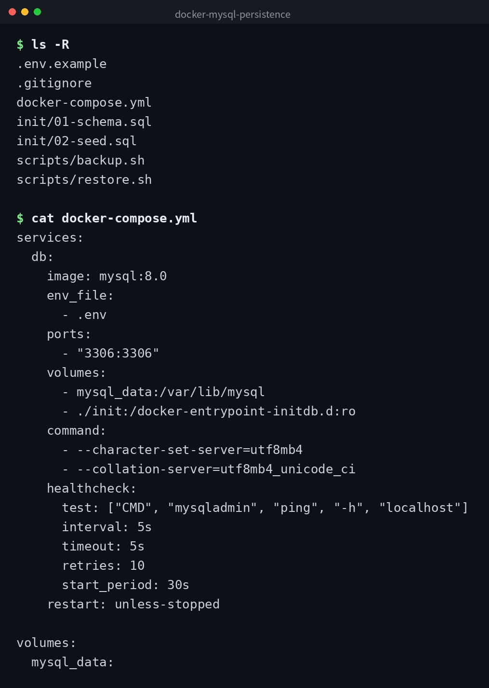

English | [日本語](ja/README.md) | [한국어](ko/README.md)


# docker-mysql-persistence

A practical sample for running MySQL 8.0 with Docker Compose and persisting data using a named volume. You can verify that data remains even after containers are removed.

## Demo



## Prerequisites

- Docker Engine 20.10 or later
- Docker Compose v2

## Setup

```bash
cp .env.example .env
# Edit .env to set passwords

docker compose up -d
```

It takes a few tens of seconds for the healthcheck to pass. You can check the status with:

```bash
docker compose ps
```

## How Persistence Works

The `mysql_data` defined in `docker-compose.yml` is a Docker named volume. It is managed independently from the container lifecycle, so data is retained even when containers are removed and recreated.

## Verifying Data Persistence

1. Add data:

```bash
docker compose exec db mysql -u app_user -p app_db \
  -e "INSERT INTO notes (title, body) VALUES ('Test', 'Persistence check');"
```

2. Stop and remove the containers:

```bash
docker compose down
```

3. Start again:

```bash
docker compose up -d
```

4. Verify the data remains:

```bash
docker compose exec db mysql -u app_user -p app_db \
  -e "SELECT * FROM notes;"
```

If the previously added row appears, persistence is working correctly.

## Backup / Restore

### Backup

```bash
bash scripts/backup.sh
```

A timestamped `.sql` file is saved to the `backups/` directory. Older backups beyond the latest 7 are automatically deleted.

### Restore

```bash
bash scripts/restore.sh backups/backup_20260101_120000.sql
```

Specify the path to the `.sql` file you want to restore as an argument.

## Full Cleanup

To remove volumes along with containers, use the `-v` option. This operation will delete all database data permanently.

```bash
docker compose down -v
```

## Clone

```bash
git clone https://github.com/mivork/docker-mysql-persistence.git
```
