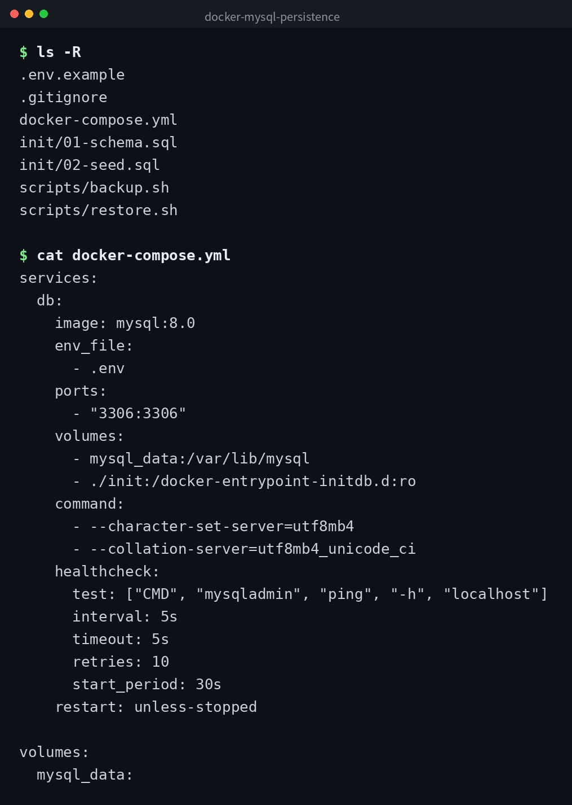

[English](../README.md) | 日本語 | [한국어](../ko/README.md)


# docker-mysql-persistence

Docker Compose で MySQL 8.0 を起動し、名前付きボリュームでデータを永続化するサンプルです。
コンテナを削除してもデータが残ることを確認できます。

## デモ



## 前提

- Docker Engine 20.10 以上
- Docker Compose v2

## セットアップ

```bash
cp .env.example .env
# .env を編集してパスワードを設定

docker compose up -d
```

起動後、healthcheck が通るまで数十秒かかります。状態は以下で確認できます。

```bash
docker compose ps
```

## 永続化の仕組み

`docker-compose.yml` で定義している `mysql_data` は Docker の名前付きボリュームです。
コンテナのライフサイクルとは独立して管理されるため、コンテナを削除・再作成してもボリューム内のデータは保持されます。

## データが残ることの確認手順

1. データを追加します。

```bash
docker compose exec db mysql -u app_user -p app_db \
  -e "INSERT INTO notes (title, body) VALUES ('テスト', '永続化の確認');"
```

2. コンテナを停止・削除します。

```bash
docker compose down
```

3. 再度起動します。

```bash
docker compose up -d
```

4. データが残っていることを確認します。

```bash
docker compose exec db mysql -u app_user -p app_db \
  -e "SELECT * FROM notes;"
```

先ほど追加した行が表示されれば、永続化が機能しています。

## バックアップ / リストア

### バックアップ

```bash
bash scripts/backup.sh
```

`backups/` ディレクトリに日時つきの `.sql` ファイルが出力されます。
最新 7 件を超えた古いバックアップは自動的に削除されます。

### リストア

```bash
bash scripts/restore.sh backups/backup_20260101_120000.sql
```

引数にリストアしたい `.sql` ファイルのパスを指定してください。

## 完全削除

ボリュームごと削除する場合は `-v` オプションを付けてください。
この操作を実行すると、データベースの全データが失われます。

```bash
docker compose down -v
```

## クローン

```bash
git clone https://github.com/mivork/docker-mysql-persistence.git
```
