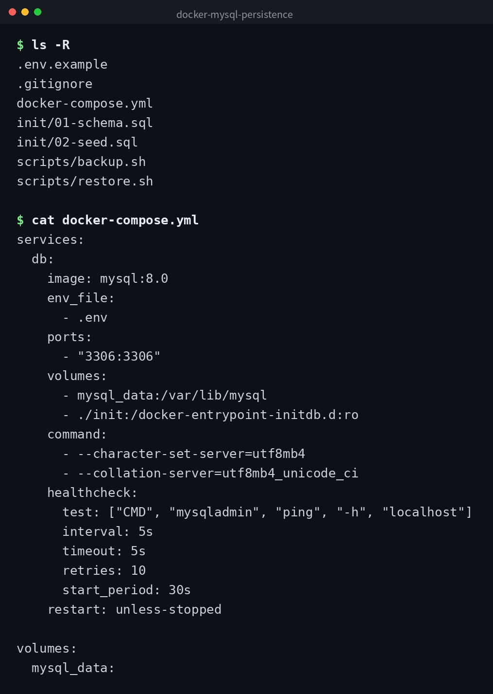

[English](../README.md) | [日本語](../ja/README.md) | 한국어


# docker-mysql-persistence

Docker Compose로 MySQL 8.0을 실행하고 네임드 볼륨으로 데이터를 영속화하는 샘플입니다. 컨테이너를 삭제해도 데이터가 유지되는 것을 확인할 수 있습니다.

## 데모



## 전제 조건

- Docker Engine 20.10 이상
- Docker Compose v2

## 설정

```bash
cp .env.example .env
# .env를 편집하여 비밀번호를 설정

docker compose up -d
```

기동 후 healthcheck가 통과할 때까지 수십 초 걸립니다. 상태는 아래 명령어로 확인할 수 있습니다.

```bash
docker compose ps
```

## 영속화 구조

`docker-compose.yml`에서 정의한 `mysql_data`는 Docker의 네임드 볼륨입니다. 컨테이너의 라이프사이클과 독립적으로 관리되므로 컨테이너를 삭제하거나 재생성해도 볼륨 내의 데이터는 유지됩니다.

## 데이터 유지 확인 절차

1. 데이터를 추가합니다.

```bash
docker compose exec db mysql -u app_user -p app_db \
  -e "INSERT INTO notes (title, body) VALUES ('테스트', '영속화 확인');"
```

2. 컨테이너를 중지하고 삭제합니다.

```bash
docker compose down
```

3. 다시 기동합니다.

```bash
docker compose up -d
```

4. 데이터가 유지되고 있는지 확인합니다.

```bash
docker compose exec db mysql -u app_user -p app_db \
  -e "SELECT * FROM notes;"
```

이전에 추가한 행이 표시되면 영속화가 정상적으로 동작하고 있는 것입니다.

## 백업 / 복원

### 백업

```bash
bash scripts/backup.sh
```

`backups/` 디렉토리에 타임스탬프가 포함된 `.sql` 파일이 출력됩니다. 최신 7개를 초과한 오래된 백업은 자동으로 삭제됩니다.

### 복원

```bash
bash scripts/restore.sh backups/backup_20260101_120000.sql
```

복원할 `.sql` 파일의 경로를 인수로 지정하세요.

## 완전 삭제

볼륨까지 함께 삭제하려면 `-v` 옵션을 붙이세요. 이 작업을 실행하면 데이터베이스의 모든 데이터가 삭제됩니다.

```bash
docker compose down -v
```

## 클론

```bash
git clone https://github.com/mivork/docker-mysql-persistence.git
```
